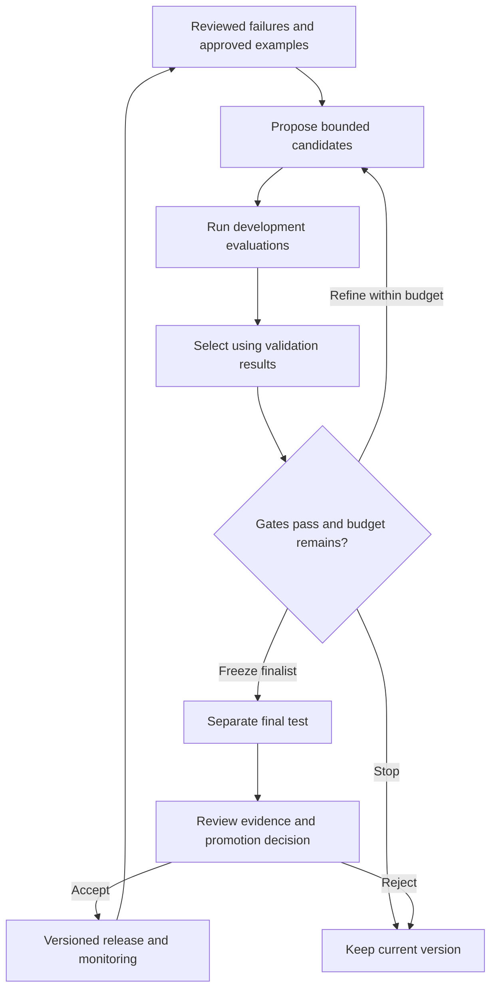

# Recursive self-improvement and continuous agent improvement

Research checked: **24 October 2026**.

[Repository home](../../README.md) · [Frameworks](frameworks.md) · [Exercise](experiment-design.md) · [Sources](reading-list.md) · [Glossary](glossary.md)

A useful improvement loop collects evidence about failures, proposes a change, measures its consequences and retains the change only when it meets predeclared criteria. Repeating that process can improve an AI system without retraining its underlying model. The difficult part is establishing that the measured improvement represents better outcomes on new tasks.

The appropriate starting point depends on what should improve: GEPA can optimize prompts or other text-defined artifacts, ReasoningBank develops experience memory, and DREAM-RSI improves an exploration policy. These mechanisms solve different problems. This guide summarizes public research and proposes educational experiments; it reports no integration or benchmark results.

## Learning path

1. Read this guide to understand the different kinds of improvement and the evaluation loop.
2. Read the [framework comparison](frameworks.md) to distinguish DREAM-RSI, GEPA, Google ADK, ReasoningBank and AlphaEvolve.
3. Work through the [hypothetical experiment](experiment-design.md) to practice defining datasets, metrics and candidate comparisons.
4. Use the [annotated reading list](reading-list.md) to study the original methods and revisit implementation details.

Use the [glossary](glossary.md) whenever a term is unfamiliar. By the end, you should be able to identify what an improvement loop changes, design a fair comparison, and explain why validation gains can fail to generalize.

## What changes between iterations

The term RSI is used broadly. For engineering discussions, identify exactly what changes and what persists.

| Mechanism | What changes | What carries into the next task or cycle |
| --- | --- | --- |
| Answer refinement | A draft answer is reviewed and revised | Usually nothing beyond the current answer |
| Prompt or workflow optimization | Instructions, evidence selection or a bounded workflow | A versioned application configuration or implementation |
| Experience memory | Retrieved lessons from earlier successes and failures | A memory collection with provenance |
| Model training | Model parameters | A new model checkpoint |
| Improvement of the optimizer | The policy for selecting and refining experiments | A revised search strategy |

The last row adds recursion to the improvement process itself: the system changes how it searches for improvements. Google's DREAM-RSI is a concrete example of exploration-policy evolution. Its discovery model and task evaluator remain fixed. [DREAM-RSI repository](https://github.com/google-research/dream-rsi)

Persistent application improvement is already useful. It should not be presented as evidence of unlimited progress or automatic improvement of model weights.

## Anatomy of a measured loop

The final test is outside candidate generation and selection. Its case-level feedback should not flow back into the same search. Once its results guide future development, treat that set as exposed and obtain new sealed cases for later generalization claims.

The loop needs six responsibilities:

- **Example collection:** retain task inputs, the evidence actually supplied, outputs, failures and verified outcomes.
- **Candidate proposal:** change a bounded surface, such as an instruction string or evidence-selection function.
- **Execution:** run candidates through the real application under comparable conditions.
- **Evaluation:** provide both scores and actionable explanations of failure.
- **Selection and promotion:** compare against the incumbent and inspect regressions before accepting a version.
- **Experiment records:** preserve ancestry, identities, budgets, results and the promotion decision.

GEPA provides reflective candidate optimization against a user-supplied evaluator. It does not supply domain truth automatically. [GEPA API](https://gepa-ai.github.io/gepa/api/optimize_anything/optimize_anything/)

## Build an evaluator that rewards the intended behavior

For document question answering, measure factual answers, source-supported claims, appropriate uncertainty and coverage of the requested information. Track completion, latency and resource use alongside quality. Structural checks can establish valid output and permitted source IDs; semantic assessment must establish whether the source supports each claim.

Use deterministic checks where the expected property is exact. Use a stable rubric for semantic judgments and calibrate model-based judgments against subject-matter review. A second model can provide a separate judgment, but using a different model alone does not establish independence or correctness.

Avoid a single score that lets serious regressions disappear inside an average. For example, an improvement in phrasing should not compensate for a fabricated factual claim. A proposed acceptance policy can combine hard failure conditions with minimum usefulness, completion and latency requirements.

Google's evaluation codelab demonstrates why metric choice matters: an optimization loop can improve a proxy while harming the actual objective. [Google self-evolving-loop codelab](https://codelabs.developers.google.com/codelabs/table-for-n/instructions)

### Two illustrative metric traps

**Failure exclusion:** candidate A completes 100 of 100 cases and answers 80 correctly. Candidate B completes 50 and answers 45 correctly. Completed-only accuracy favors B, 90% versus 80%, while correct outcomes across all attempts favor A, 80% versus 45%. Report both completion and quality; do not reward disappearance of difficult cases.

**Unhelpful abstention:** a system that always says there is insufficient evidence may avoid fabricated answers while providing little assistance. Pair grounding with answer completeness. Insufficient evidence is still the correct answer for some cases, so it must not receive an automatic penalty either.

These numbers are hypothetical and are not benchmark measurements.

## Separate learning from measurement

| Dataset | Role | Available to the optimizer? |
| --- | --- | --- |
| Development | Failure analysis and candidate generation | Yes |
| Validation | Candidate selection and tuning decisions | Yes, through evaluation feedback |
| Final test | Estimate performance after the candidate is frozen | No; run through a separately controlled evaluation path |

Split by document family, task category or time where related examples could otherwise leak across sets. Retain the exact corpus and scoring-key versions. Adding new labels must not silently rewrite historical results.

For non-deterministic outputs, repeat paired comparisons where needed and report variability. Keep model identity, budgets and execution conditions comparable. A single run on a small synthetic set cannot establish production accuracy.

## Keep the loop bounded

Predeclare candidate count, evaluation-call and runtime budgets, no-progress stopping conditions and permitted changes. Keep the evaluator, final-test access and application authority outside the candidate's control. Preserve the incumbent when no candidate clears the criteria.

Record at least the candidate and parent identities; source, prompt and model identities; dataset and rubric versions; all attempted and failed cases; per-dimension scores; timing and resource observations; and the reason for acceptance or rejection. Store only data permitted for the experiment. Local inference does not make a cloud-based proposer or judge local.

## Questions to check understanding

1. Why can a valid evidence ID still accompany an unsupported claim?
2. Why does an improving validation score not establish improvement on new tasks?
3. Why is a user's positive rating insufficient to establish factual correctness?
4. Which costs remain when DREAM-RSI replays history without executing new candidates?
5. When would it make sense to improve the experiment-selection policy rather than the task prompt?

Suggested answers: citation membership does not establish entailment; validation participates in selection; satisfaction can reflect style or agreement rather than correctness; policy generation and new online discovery still cost resources; search-policy learning is most useful once a trustworthy evaluator and substantial experiment history exist.
